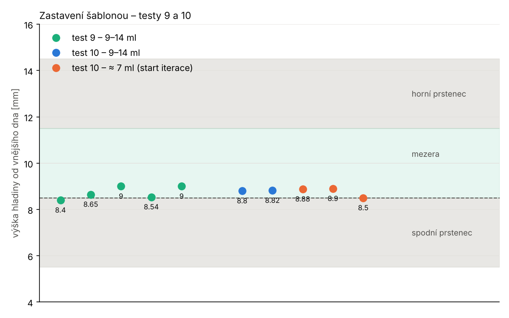

# Analýza testu 10 – šablona + kontroly, start jako v iteraci

Log z 13. 11. 16:55 (sketch testu 10, 5 cyklů). Graf:
`python3 analyza/test10.py <log_t9> <log_t10> img10`.

## Výsledek

| cyklus | náplň | start C3/C1 | C3/C1 v maximu | zastavilo | C3/max při stopu | výška [mm] |
|---|---|---|---|---|---|---|
| 1 | 9–14 ml | 0,991 | 0,922 | podíl | 0,790 | 8,8 |
| 2 | 9–14 ml | 0,940 | 0,923 | podíl | 0,783 | 8,82 |
| 3 | ≈ 7 ml | 0,964 | 0,927 | podíl | 0,787 | 8,88 |
| 4 | ≈ 7 ml | **0,900** | **0,893** | podíl | **0,812** | 8,9 |
| 5 | ≈ 7 ml | **0,902** | **0,902** | podíl | **0,799** | 8,5 |

- **Start jako v iteraci funguje:** cykly s ≈ 7 ml 8,76 ± 0,23 mm, s plnou
  lahvičkou 8,74 ± 0,23 mm. **Testy 9+10 dohromady (10 cyklů):
  8,75 ± 0,21 mm, rozsah 8,4–9,0 mm.**
- Kontrola shody vždy `shoda OK`. Záloha ani pojistky nezasáhly.
- Suché hodnoty prázdné studny C1 2,054 / C3 1,923 pF (sd 0,002). S lahvičkou
  byl klid o 1,4–2,2 pF výš.

## Co ukázaly cykly s ≈ 7 ml

- **Maximum C3 se podcení:** 4,34–4,43 pF proti 4,46–4,51 pF u plné
  lahvičky (start uprostřed plató, nejvyšší část se nevidí). Šablona
  C3 ≤ 0,78 × max by proto zastavila o něco později.
- **Zachránil to podíl C3/C1 ≤ 0,68**, který na maximu nezávisí: zastavil
  při C3/max 0,80–0,81, výška 8,5–8,9 mm. Obě kritéria se doplňují:
  podíl hlídá start uprostřed plató, šablona plnou lahvičku.
- **Kontroly 0,88 jsou na hraně:** start C3/C1 0,900 a 0,902 (rezerva 0,02),
  C3/C1 v maximu 0,893 (rezerva 0,013). Při trochu nižším startu (menší
  zbytek, méně roztoku) by kontrola **zastavila zbytečně**.

## Zkouška chybějící lahvičky

V logu chybí. Cyklus 1 se potvrdil rovnou s lahvičkou. Ze starších dat
(log 15:46, cyklus 4 bez lahvičky): klid C1 2,069 / C3 1,932 pF, tedy
**+0,015 / +0,009 pF** nad suchou hodnotou. Práh +0,5 pF by start odmítl.
Na zařízení to ale zatím ověřené není.

## Doporučení

1. **Snížit práh obou kontrol C3/C1 (start, maximum) z 0,88 na 0,80.**
   Podceněné maximum nevadí, protože podíl C3/C1 ≤ 0,68 zastaví nezávisle
   na něm. Kontroly mají chytit jen hrubě špatný stav (hladina už v mezeře:
   C3/C1 ≈ 0,5–0,6).
2. Zkoušku bez lahvičky udělat krátce samostatně (stačí `g` a první cyklus).
3. Kritérium je připravené k převodu do produkčního `capacitive.cpp` /
   `state_machine.cpp`.
