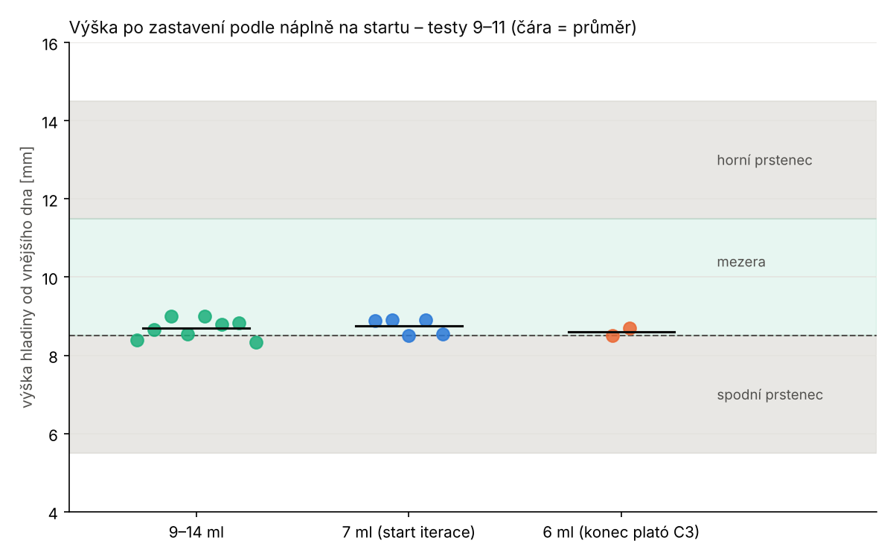

# Analýza testu 11 – kontroly 0,80, bez lahvičky, start 6 ml

Log z 13. 11. 17:26 (sketch testu 11, **bez** dodatečného stínění studny).
Graf: `python3 analyza/test11.py <log_t9> <log_t10> <log_t11> img11`.

## Výsledek

| cyklus | náplň | start C3/C1 | C3/C1 v maximu | zastavilo | C3/max při stopu | výška [mm] |
|---|---|---|---|---|---|---|
| 1 | bez lahvičky | 0,938 | – | **odmítnuto**: C1 −0,005, C3 −0,003 pF nad suchou | – | – |
| 1 | 9–14 ml | 0,961 | 0,945 | šablona | 0,774 | 8,34 |
| 2 | 7 ml | 0,878 | 0,899 | podíl | 0,790 | 8,9 |
| 3 | 7 ml | 0,908 | 0,906 | podíl | 0,787 | 8,54 |
| 4 | 6 ml | **0,861** | **0,826** | podíl **hned při aktivaci** | 0,846 | 8,5 |
| 5 | 6 ml | **0,831** | **0,822** | podíl **hned při aktivaci** | 0,841 | 8,7 |

- **Kontrola přítomnosti lahvičky funguje:** prázdná studna dala stejné
  hodnoty jako suchá (rozdíl −0,005 pF, práh +0,5 pF), start odmítnut.
- **Všechny výšky v cíli.** Testy 9–11 dohromady (15 cyklů):
  **8,70 ± 0,22 mm** (8,34–9,0), zbytek ≈ 4,1 ml – nezávisle na náplni:

| start | výška [mm] |
|---|---|
| 9–14 ml (8 cyklů) | 8,69 ± 0,25 |
| 7 ml (5 cyklů) | 8,74 ± 0,21 |
| 6 ml (2 cykly) | 8,60 ± 0,14 |

- Kontrola shody vždy `shoda OK`. Se starým prahem 0,88 by oba cykly
  se 6 ml **zbytečně skončily chybou** (start 0,83–0,86, maximum 0,82).

## Nález: aktivace brzdí podíl C3/C1

U 6 ml zastavil podíl C3/C1 **ve stejném okně, kdy se detektor aktivoval**.
Podíl byl pod 0,68 už o jeden koš dřív a čekal jen na aktivaci
(C3 ≤ 0,85 × max). Při startu za plató je maximum C3 podceněné, aktivace
přijde pozdě a s ní i podíl. U 6 ml to stálo jeden koš (≈ 0,1 mm), při
ještě nižším startu by to bylo víc – **v nebezpečném směru**.

Podíl na maximu C3 nezávisí, aktivaci tedy nepotřebuje. Ve všech 15
cyklech byl před aktivací podíl ≥ 0,72 (kromě obou 6 ml, kde už měl
zastavit) → bez aktivace by se nikde nezastavilo předčasně.

## Doporučení (před převodem do produkce)

1. **Podíl C3/C1 ≤ 0,68 hlídat od začátku tlačení**, ne až po aktivaci.
   Aktivace zůstane jen pro šablonu C3/max a pro vrchol.
2. **Kontrolu maxima z plató jen zapisovat** (nezastavovat). Při startu
   6 ml vyšla 0,82 proti prahu 0,80 – rezerva 0,02. Podceněné maximum
   už neohrožuje, protože podíl zastaví nezávisle.
3. **Kontrola před tlačením C3/C1 ≥ 0,70** (místo 0,80). V mezeře je podíl
   ≈ 0,5–0,6, start 6 ml 0,83–0,86 – práh 0,70 je uprostřed.
4. Kontrolu přítomnosti lahvičky (suchá + 0,5 pF) ponechat.

## Šum (pro srovnání se stíněním)

| | C1 sd [pF] | C3 sd [pF] |
|---|---|---|
| prázdná studna (suché hodnoty) | 0,001 | 0,002 |
| bez lahvičky v cyklu 1 | 0,030 | 0,015 |
| s lahvičkou, klid `k` | 0,38–0,50 | 0,31–0,40 |

Šum vzniká **až s kapalinou v lahvičce**. Prázdná studna je klidná.
Odpovídá to nedefinované zpáteční cestě přes kapalinu (CLAUDE.md, varianta B
stínění: uzemněná klec dá vodě stabilní návrat). Po stínění porovnat
hlavně klid `k` s lahvičkou.
