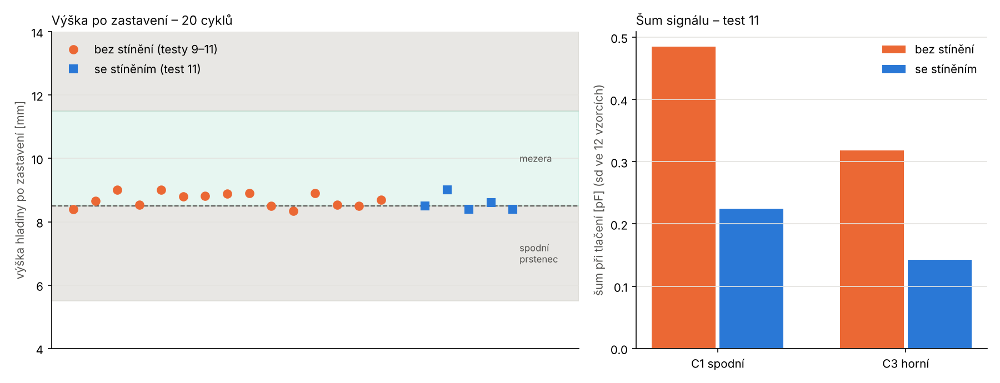

# Analýza testu 11 se stíněním studny

Log z 24. 11. 13:56 (sketch testu 11 beze změny, nové stínění studny).
Srovnání s během bez stínění (13. 11. 17:26) a s testy 9–10. Graf:
`python3 analyza/test11_stineni.py <t9> <t10> <t11> <t11_stineni> img11s`.

## Výsledek

| cyklus | náplň | start C3/C1 | C3/C1 v maximu | zastavilo | C3/max | výška [mm] |
|---|---|---|---|---|---|---|
| 1 | 9–14 ml | 0,983 | 0,937 | šablona | 0,779 | 8,5 |
| 2 | 7 ml | 0,925 | 0,908 | podíl | 0,795 | 9,0 |
| 3 | 7 ml | 0,915 | 0,898 | podíl | 0,788 | 8,4 |
| 4 | 6 ml | 0,858 | **0,814** | podíl hned při aktivaci | 0,849 | 8,6 |
| 5 | 6 ml | 0,874 | 0,836 | podíl | 0,815 | 8,4 |

- **Se stíněním 8,58 ± 0,25 mm**, bez stínění (testy 9–11) 8,70 ± 0,22 mm.
  Rozdíl 0,1 mm je uvnitř rozptylu ručního měření.
- **Všech 20 cyklů (testy 9–11, s i bez stínění): 8,67 ± 0,23 mm,
  rozsah 8,34–9,0 mm, zbytek ≈ 4,1 ml.** Nezávisle na náplni 6–14 ml.
- Kontrola shody vždy `shoda OK`. Žádné předčasné ani zmeškané zastavení,
  záloha ani pojistky nezasáhly.

## Co stínění změnilo

| | bez stínění | se stíněním |
|---|---|---|
| šum při tlačení C1 (sd ve 12 vzorcích) | 0,49 pF | **0,22 pF** |
| šum při tlačení C3 | 0,32 pF | **0,14 pF** |
| klid po zastavení C1 / C3 | 0,55 / 0,20 pF | 0,21 / 0,07 pF |
| suché hodnoty C1 / C3 | 2,05 / 1,92 pF | 1,69 / 1,74 pF |
| maximum C3 | 4,1–4,5 pF | 3,6–4,0 pF |
| CAPDAC | 0 | 0 |

- **Šum klesl ≈ 2,2×**, signál jen o ≈ 10 % → poměr signál/šum ≈ 2× lepší.
- **Tvar v šabloně se nezměnil:** zastavení při C3/max 0,78–0,85, podíl
  C3/C1 v maximu 0,81–0,94, nárůst rozdílu 0,19–0,33 × max C3 – stejně
  jako bez stínění. Kritéria platí beze změny prahů.
- Stínění bylo zapojené správně (CAPDAC 0, žádné navázání kabelu).

## Nové a potvrzené slabiny

1. **Kontrola přítomnosti lahvičky je se stíněním na hraně.** V cyklu 1
   (hladina vysoko, nad `SHLD2`) byl klid jen **+0,67 / +0,58 pF** nad suchou
   hodnotou při prahu +0,5 pF. Kapalina nad `SHLD2` je buzená stíněním a
   prstence ji skoro nevidí. U 20ml lahvičky (hladina ještě výš) může
   rozdíl klesnout pod práh a kontrola by zbytečně odmítla plnou lahvičku.
   Zkouška **bez** lahvičky v tomto logu není (cyklus 1 byl rovnou
   s lahvičkou).
2. **Kontrola maxima z plató (0,80):** u 6 ml 0,814 – rezerva 0,014.
   Potvrzuje doporučení: jen zapisovat.
3. **Brzdění podílu aktivací:** u 6 ml podíl před aktivací 0,685 – opět
   zastavil až s aktivací. Potvrzuje doporučení: podíl hlídat od začátku.
4. **Start C3/C1:** 6 ml 0,858–0,874, práh 0,80 – rezerva 0,06 → 0,70.

## Lze kritickou hladinu spolehlivě detekovat?

**Ano – zastavení samo je spolehlivé:** 20 z 20 cyklů v 8,34–9,0 mm,
s i bez stínění, při startu z 6 až 14 ml, bez jediného selhání. Při
rozptylu ±0,23 mm leží i odhad nejhoršího případu (průměr − 3 sd ≈ 8,0 mm,
≈ 3,7 ml) ve spodním prstenci, daleko nad jeho spodní hranou (5,5 mm)
i nad jehlou.

**Ještě neověřeno**, než to bude platit pro přístroj:
- kontrola přítomnosti lahvičky se stíněním (prázdná studna, prázdná
  lahvička, plná 20ml lahvička),
- jiná rychlost tlačení – všechny testy běžely 1 ml / 5 s, a filtr
  (96 vzorků) posouvá zastavení úměrně rychlosti hladiny,
- pauza uprostřed sestupu C3,
- skutečný tlak pacienta (v testech hadička do nádoby).
