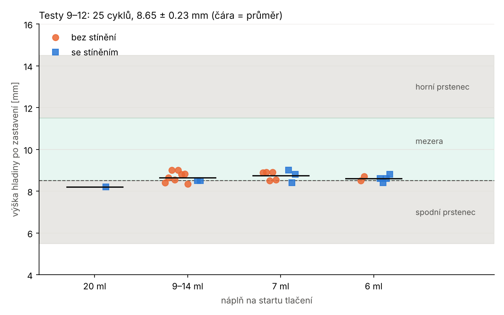

# Analýza testu 12 – podíl od začátku, kontrola lahvičky, 20 ml

Log z 24. 11. 14:26 (sketch testu 12, studna se stíněním, 1 ml / 5 s).
Graf: `python3 analyza/test12.py <t9> <t10> <t11> <t11_stineni> <t12> img12`.

## Výsledek

| | náplň | start C3/C1 | nad suchou C1 / C3 [pF] | zastavilo | C3/max | výška [mm] |
|---|---|---|---|---|---|---|
| studna prázdná | – | – | 0 / 0 (C1 1,686, C3 1,737) | – | – | – |
| prázdná suchá lahvička | – | – | **+0,050 / +0,073** | – | – | – |
| 1 | **20 ml** | 0,952 | +1,50 / +1,29 | podíl (2 doplnění) | 0,784 | **8,2** |
| 2 | 9–14 ml | 0,999 | +1,54 / +1,49 | podíl | 0,772 | 8,5 |
| 3 | 7 ml | 0,927 | +1,92 / +1,61 | podíl | 0,788 | 8,8 |
| 4 | 6 ml | 0,867 | +1,89 / +1,36 | podíl **před aktivací** | 0,853 | 8,6 |
| 5 | 6 ml | 0,851 | +1,98 / +1,39 | podíl s aktivací | 0,847 | 8,8 |

- **Test 12: 8,58 ± 0,25 mm. Testy 9–12 (25 cyklů): 8,65 ± 0,23 mm,
  rozsah 8,2–9,0 mm, zbytek ≈ 4,1 ml (nejméně 3,8 ml).**
- **20 ml zastavilo správně** (8,2 mm, nejníž ze všech, ale v rozptylu).
  Tlačení potřebovalo 2 doplnění vzduchu, druhé až **po aktivaci** – pacient
  se uprostřed sestupu C3 zavřel a znovu otevřel a detekce pokračovala bez
  chyby.
- **Podíl od začátku funguje:** v cyklu 4 zastavil podíl ještě **před**
  aktivací (v logu chybí řádek `# aktivace`). Při ostatních startech byl
  podíl před aktivací ≥ 0,73 → žádné předčasné zastavení.
- Kontrola shody vždy `shoda OK`, kontrola maxima z plató bez zápisu
  (nejníž 0,815). Záloha ani pojistky nezasáhly.

| start | cykly | výška [mm] |
|---|---|---|
| 20 ml | 1 | 8,2 |
| 9–14 ml | 10 | 8,65 ± 0,24 |
| 7 ml | 8 | 8,74 ± 0,23 |
| 6 ml | 6 | 8,60 ± 0,14 |

## Kontrola přítomnosti lahvičky

| stav | nad suchou hodnotou (menší z C1/C3) |
|---|---|
| bez lahvičky (test 11, bez stínění) | −0,005 pF |
| prázdná suchá lahvička | **+0,05 pF** |
| **práh** | **+0,25 pF** |
| lahvička s kapalinou (test 11 se stíněním, cyklus 1) | +0,58 pF |
| lahvička s kapalinou (test 12, včetně 20 ml) | +1,29 až +1,98 pF |

Práh 0,25 pF leží mezi prázdnou lahvičkou (+0,05) a nejnižší naměřenou
plnou (+0,58). Odmítne i prázdnou lahvičku, nejen chybějící.

⚠️ **Zkouška bez lahvičky na začátku cyklu 2 v logu chybí** (cyklus 2 se
potvrdil rovnou s lahvičkou). Prázdná studna je ale přímo suchá hodnota
(rozdíl 0) a prázdná lahvička dává +0,05 pF – obojí je pod prahem.

Proč byl cyklus 1 testu 11 se stíněním tak nízko (+0,58 pF), když 20 ml
teď dává +1,29 pF, z logu poznat nejde (usazení lahvičky, mokrá stěna?).
Rezerva k prahu je i tak dvojnásobná.

## Drobnost v logu

Když podíl zastaví před aktivací, řádek `# STOP` vypíše
`dmax=-1000000000.000 @ t=0` (maximum rozdílu se sleduje až po aktivaci).
Na zastavení to vliv nemá, v produkci vypisovat jen platné hodnoty.

## Závěr

Detekce kritické hladiny je **spolehlivá**: 25 z 25 cyklů v 8,2–9,0 mm
při startu z 6, 7, 9–14 i 20 ml, s i bez stínění, i s doplněním vzduchu
uprostřed sestupu. Kontroly (lahvička, výchozí stav, shoda) bez falešných
poplachů. Kritérium je připravené k převodu do produkce
(`PLAN_PREVODU.md`, upravit podle testu 12: podíl od začátku, kontrola
maxima jen zápis, start ≥ 0,70, lahvička ≥ 0,25 pF).

Zbývá ověřit až v produkčním firmwaru: pauzu uprostřed sestupu a chování
při skutečném tlaku pacienta.
