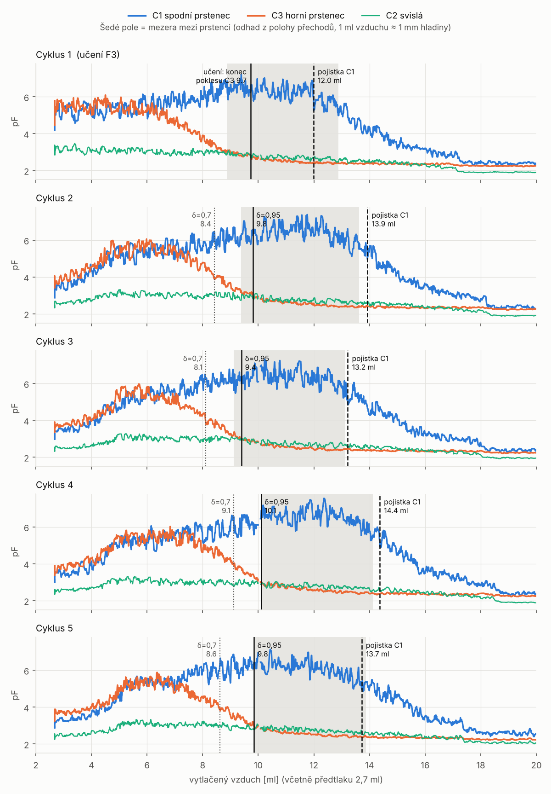
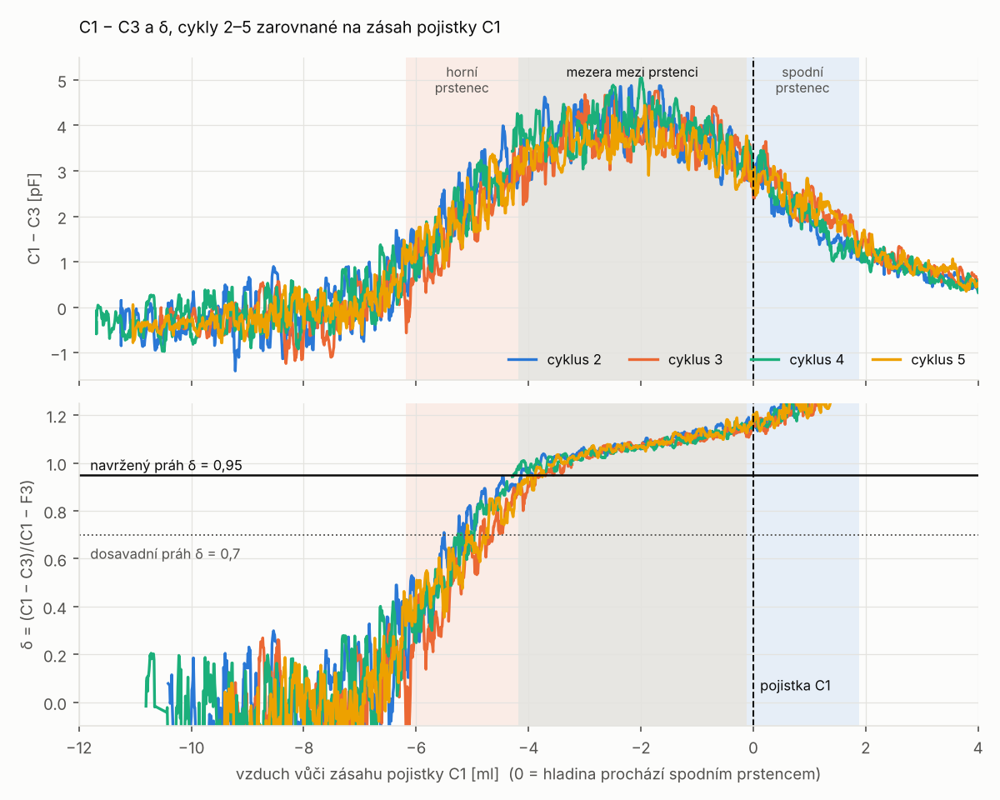
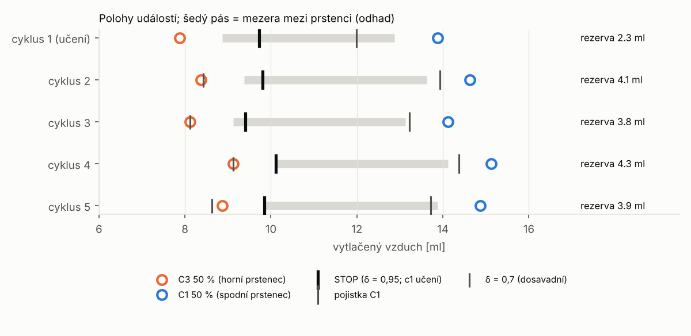

# Test 5 – profily, vyhodnocení (5 cyklů, režim PROFIL)

Data: 5 cyklů po **20 ml vzduchu**, náplň od oka a pokaždé jiná (nezapsaná),
1 ml / 5 s, předtlak 2,7 ml, nestíněná lahvička. Mapa kanálů podle
dotykového testu (C1 spodní = CIN2, C2 svislá = CIN3, C3 horní = CIN1).
Detekce běžela jen „na stínu" (zapisovala, nic nezastavila). Cyklus 1 se
naučil **F3 = 2,806 pF, D1 = 3,533 pF**, cykly 2–5 s nimi počítaly δ.

Opakování analýzy (ze složky `tools/level_stop/`):
```
python3 analyza/analyza_profil.py <log.txt>
python3 analyza/grafy_profil.py <log.txt>
```

---

## Shrnutí

1. **Všech 5 cyklů se vyprázdnilo**, 20 ml vzduchu stačí. C1 dosedá na
   podlahu kolem 17–19 ml.
2. **Průběh je mezi cykly prakticky totožný**, přestože náplň byla
   pokaždé jiná. Rozestup přechodů horního a spodního prstence je
   **6,05 ± 0,11 ml vzduchu**. Středy prstenců jsou 6 mm od sebe, takže
   **1 ml vzduchu ≈ 1 mm hladiny**.
3. **Hladina je mezi prstenci, právě když δ leží na plató ≈ 1,0–1,15**
   a pojistka C1 ještě nezasáhla. Tyto dvě podmínky jsou signálové hranice
   okna (obr. 2).
4. **Dosavadní práh δ = 0,7 zastavuje příliš brzy.** Padá přesně na
   50 % přechod horního prstence, tedy zhruba **do středu horního
   prstence**, ~1 ml nad mezerou.
5. **Navržený práh δ = 0,95** zastaví na horním okraji mezery (spodní hrana
   horního prstence). Do zásahu pojistky pak zbývá **4,0 ± 0,2 ml**.
6. Pojistka C1 zasahuje ~0,3 ml za koncem mezery, když hladina vstupuje
   do spodního prstence. Je to správně umístěná poslední záchrana.

---

## Obr. 1 – profily všech cyklů



Šedé pole je **odhad mezery mezi prstenci**: od 50 % přechodu C3 + 1 ml
(spodní hrana horního prstence) po 50 % přechodu C1 − 1 ml (horní hrana
spodního prstence). Prstenec má výšku 2 mm, tedy ±1 ml kolem středu.

Průběh každého cyklu:
- **Pod `SHLD2`** (cca do 5–6 ml) oba prstence stoupají společně na ~5,5 pF.
- **Horní prstenec se odkrývá** (C3 klesá na ~2,4 pF), spodní dál stoupá
  na 6,3–7 pF. To je stav mezi prstenci.
- **Spodní prstenec se odkrývá** (C1 klesá), pak všechno na podlaze.
- **Svislá elektroda C2** se mění málo (2,3 → 3,1 → 2,0 pF) a k detekci
  hladiny nic nepřidává.

## Obr. 2 – signálové hranice okna



Cykly 2–5 jsou zarovnané na zásah pojistky C1 (x = 0). Křivky se kryjí
v rámci šumu. To je hlavní výsledek: **tvar nezávisí na náplni ani na
cyklu**.

| úsek (vůči pojistce) | hladina | C1 − C3 | δ |
|---|---|---|---|
| < −6 ml | nad horním prstencem | −0,5 až +0,5 pF | < 0,3 |
| −6 až −4 ml | v horním prstenci | strmě stoupá | 0,3 → 0,95 |
| **−4 až 0 ml** | **mezi prstenci** | **+3 až +4,5 pF** | **0,95 → 1,15 (plató)** |
| 0 až +2 ml | ve spodním prstenci | klesá | > 1,15, C1 padá |

**Hranice pro zastavení tlačení:**
- **Nejdříve:** δ ≥ 0,95 (horní prstenec odkrytý).
- **Nejpozději:** pojistka C1. Spodní prstenec spadl pod polovinu svého
  vzestupu, hladina do něj vstupuje.

Samotné δ spodní hranici neurčí. Pod spodním prstencem δ dál roste (C1
i C3 jdou k podlaze). Spodní hranici proto musí hlídat pojistka C1.

## Obr. 3 – polohy událostí v jednotlivých cyklech



| cyklus | C3 50 % | δ = 0,7 | **δ = 0,95** | pojistka C1 | C1 50 % | rezerva δ 0,95 → pojistka |
|---|---|---|---|---|---|---|
| 1 (učení) | 7,88 | – | (učení 9,73) | 11,99 | 13,88 | (2,3) |
| 2 | 8,38 | 8,43 | **9,81** | 13,93 | 14,62 | 4,1 |
| 3 | 8,12 | 8,11 | **9,40** | 13,22 | 14,12 | 3,8 |
| 4 | 9,12 | 9,12 | **10,11** | 14,37 | 15,12 | 4,3 |
| 5 | 8,88 | 8,62 | **9,85** | 13,72 | 14,88 | 3,9 |

(ml vytlačeného vzduchu včetně předtlaku)

Rezerva od zastavení k pojistce pro různé prahy (cykly 2–5):

| práh δ | rezerva [ml] |
|---|---|
| 0,5 | 5,85 ± 0,26 |
| 0,6 | 5,46 ± 0,15 |
| 0,7 | 5,24 ± 0,19 |
| 0,8 | 4,81 ± 0,23 |
| 0,9 | 4,32 ± 0,17 |
| **0,95** | **4,02 ± 0,21** |

Rozptyl polohy zastavení vůči pojistce je ~0,2 ml vzduchu, tedy ~0,2 mm
hladiny, při mezeře 4 mm.

---

## Další zjištění

- **Učení (cyklus 1)** zastavilo na konci poklesu C3 (9,73 ml), tedy níž
  než δ = 0,95: 2,3 ml před pojistkou. V běhu se zastavením to obsluha
  viděla jako „horní hrana C1", což souhlasí.
- **F3 z učení** (2,81 pF) je vyšší než skutečná podlaha C3 (2,24 pF
  v klidu, ~2,4 pF při tlačení). Učení končí dřív, než C3 úplně dosedne.
  Proto δ na plató přesahuje 1. Na polohu prahů to vliv nemá, všechny
  cykly používají stejné F3.
- **Pojistka v cyklu 1** zasáhla dřív (12,0 ml, 0,9 ml před koncem mezery).
  Cyklus 1 začínal s hladinou už pod `SHLD2`: C1/C3 v klidu 3,98/4,15 pF
  proti ~3,0/3,4 pF v cyklech 2–5. Základ pojistky (klid C1) byl proto
  vyšší.
- **Šum v prázdné lahvičce:** C1 0,09 pF, C3 0,03 pF. Spodní prstenec je
  hlučnější i bez kapaliny, jako v testu 3.

## Doporučení

1. **Práh zastavení změnit na δ = 0,95** (`d0.95`). Zastavení pak padne do
   horní části mezery s rezervou ~4 ml vzduchu k pojistce.
2. **Ověřit vizuálně** v režimu zastavení (`v0`, `d0.95`), že hladina stojí
   těsně pod horním prstencem. Převod 1 ml ≈ 1 mm je odvozený z rozestupu
   přechodů, ne změřený.
3. **Svislou elektrodu C2** pro detekci nepoužívat. Může sloužit nanejvýš
   jako kontrola pohybu hladiny.
