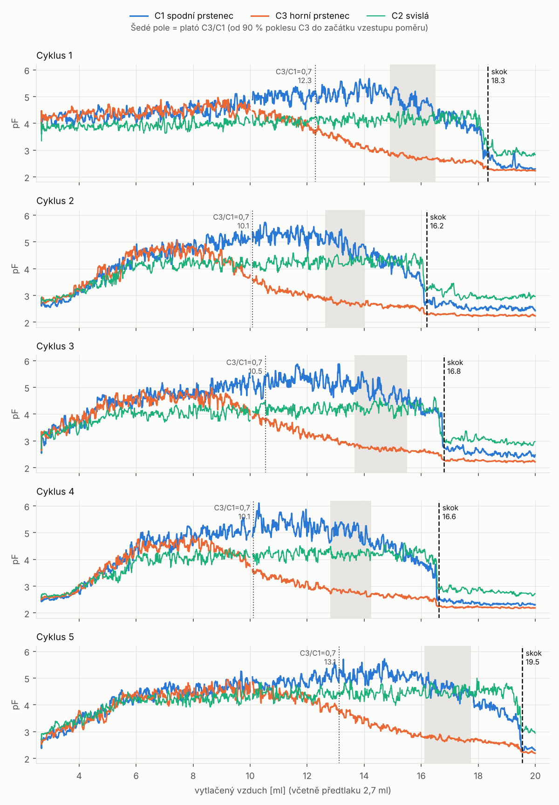
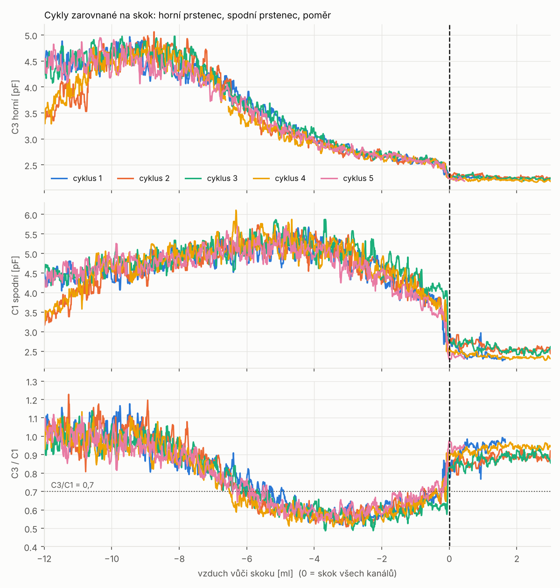
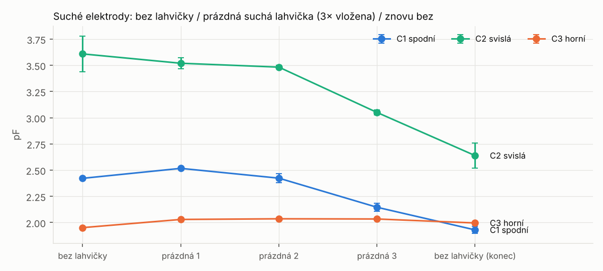
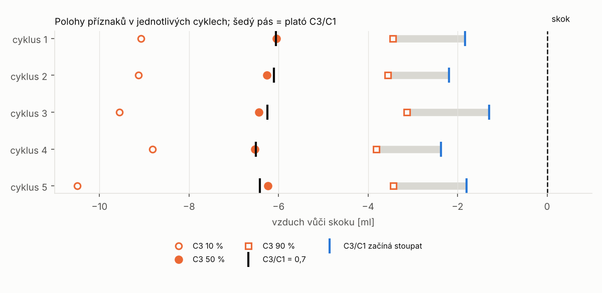

# Test 6 – vyhodnocení (studna, 5 cyklů po 20 ml vzduchu)

Data: log z 11. 11. 2026. Měření suchých elektrod (`D`) a 5 cyklů v režimu
PROFIL (20 ml vzduchu, náplň od oka, nezapsaná). Mapa kanálů `n123`:
C1 = spodní prstenec, C2 = svislá elektroda, C3 = horní prstenec. Pořadí
přechodů v datech (nejdřív horní, pak spodní) mapu potvrzuje.

Geometrie studny (od vnějšího dna lahvičky): spodní prstenec 5,5–8,5 mm,
mezera 8,5–11,5 mm, horní prstenec 11,5–14,5 mm.

Opakování analýzy (ze složky `tools/level_stop/`):
```
python3 analyza/test6.py <log.txt> img6
```

Všechna „ml" jsou **ml vytlačeného vzduchu** (včetně předtlaku 2,7 ml),
pokud není řečeno jinak.

---

## Shrnutí

1. **Nový, velmi ostrý příznak: „skok".** Ve všech cyklech v jednom
   okamžiku spadnou všechny tři kanály naráz (C1 −1 až −1,5 pF, C2 −1,2 pF,
   C3 −0,3 pF) během méně než 0,3 ml. Je to nejostřejší a nejlépe
   opakovatelný bod celého průběhu. Proto jsou na něj zarovnané všechny
   polohy níže. Pravděpodobně jde o okamžik, kdy hladina dojde
   k **hrotu jehly** a přeruší se kapalinový sloupec do pacientské hadičky.
   Je potřeba ověřit (viz otázky na konci).
2. **Polohy vůči skoku jsou stálé:** 50 % poklesu horního prstence
   6,31 ± 0,19 ml před skokem, `C3/C1 ≤ 0,7` 6,27 ± 0,19 ml před skokem.
   Náplň přitom byla pokaždé jiná (skok při 16,2–19,6 ml).
3. **Poměr C3/C1 má mezi prstenci plató ≈ 0,55** (test 5 s nalepenými
   elektrodami: 0,40). Kontrast je ve studni menší, jak se čekalo
   (vzduchová mezera k lahvičce).
4. **Přechody jsou široké.** Pokles horního prstence 10–90 % trvá ~5,6 ml
   vzduchu (v testu 5 ~2,5 ml). Hranu horního prstence proto nejde trefit
   prahem ostře. Opakovatelně jde trefit jen její střed (`C3/C1 = 0,7`).
5. **Suché elektrody:** horní prstenec je stabilní (sklo přidá +0,08 pF,
   rozptyl vložení ±0,005 pF). **Spodní prstenec a svislá elektroda za
   ~1 min samovolně klesly o 0,5 pF a 1 pF** – nestabilní kanály (viz
   níže).

---

## Obr. 1 – profily všech cyklů



Průběh v každém cyklu:
- **Na začátku** (hladina u `SHLD2`) jsou oba prstence a svislá elektroda
  pohromadě na ~4–4,5 pF.
- **Horní prstenec (C3) klesá** pozvolna, ze ~4,6 na ~2,6 pF, přes ~6 ml
  vzduchu.
- **Spodní prstenec (C1)** mezitím vystoupá na ~5,2 pF. Začne klesat asi
  2 ml před skokem.
- **Svislá elektroda (C2)** drží ~4,2 pF a spadne až ve skoku.
- **Skok** (čárkovaně): všechny kanály dolů naráz.

Šedé pole je plató poměru C3/C1. Tečkovaně je místo, kde poměr klesne pod
0,7.

## Obr. 2 – zarovnání na skok



Po zarovnání na skok se všech 5 cyklů kryje v rámci šumu: horní prstenec,
spodní prstenec i jejich poměr. Odlišuje se jen začátek cyklů 2 a 4, kde
hladina startovala níž.

## Obr. 3 – suché elektrody



| krok | C1 spodní | C2 svislá | C3 horní |
|---|---|---|---|
| bez lahvičky | 2,422 ± 0,012 | 3,609 ± 0,171 | 1,952 ± 0,004 |
| prázdná lahvička 1 | 2,517 ± 0,007 | 3,520 ± 0,052 | 2,030 ± 0,005 |
| prázdná lahvička 2 | 2,424 ± 0,043 | 3,483 ± 0,016 | 2,036 ± 0,005 |
| prázdná lahvička 3 | 2,146 ± 0,038 | 3,051 ± 0,026 | 2,034 ± 0,003 |
| bez lahvičky (konec) | 1,930 ± 0,034 | 2,639 ± 0,119 | 1,996 ± 0,012 |

(pF, průměr ± sd za 10 s)

- **Horní prstenec:** příspěvek skla +0,08 pF, opakovatelnost vložení
  ±0,005 pF, drift za celou sekvenci +0,04 pF. **Měření bez lahvičky by
  pro něj v provozu stačilo.**
- **Spodní prstenec a svislá elektroda:** hodnoty v čase soustavně klesají,
  nezávisle na tom, jestli je lahvička vložená (spodní −0,5 pF, svislá
  −1 pF). Svislá má i velký šum (sd až 0,17 pF). Ani za cyklů není spodní
  prstenec v klidu s prázdnou lahvičkou stabilní: sd 0,09–0,18 pF proti
  0,04–0,06 pF u horního.
- Jsou to tytéž kanály (CIN1, CIN2), u kterých se dřív hýbalo
  s koncovkami. **Podezření na kontakt nebo kabel CIN1 a CIN2.** Dokud se
  to nevyřeší, korekce na suché kapacity u spodního prstence nemá smysl.

## Obr. 4 – polohy příznaků



Vzdálenost před skokem (ml vzduchu, průměr ± sd přes 5 cyklů):

| příznak (jen z vlastního běhu) | před skokem | rozptyl |
|---|---|---|
| C3 10 % poklesu | 9,41 | ±0,66 |
| **C3 50 % poklesu** | **6,31** | **±0,19** |
| **C3/C1 ≤ 0,7** | **6,27** | **±0,19** |
| C3 klesl o 30 % od vlastního maxima | 5,90 | ±0,23 |
| C3/C1 ≤ 0,65 | 5,92 | ±0,49 |
| C3 klesl o 35 % od vlastního maxima | 5,29 | ±0,33 |
| C3/C1 ≤ 0,6 | 5,44 | ±0,61 |
| C3 90 % poklesu | 3,47 | ±0,25 |
| C3/C1 nejníž (plató ≈ 0,55) | 3,0–4,1 | |
| C3/C1 začíná stoupat (C1 klesá) | 1,3–2,4 | |

Prahy blízko plató (0,6–0,65) jsou nepřesné, protože poměr tam klesá jen
málo a rozhoduje šum.

---

## Co z toho plyne pro zastavení

**Odhad výšky hladiny.** V testu 5 odpovídal 1 ml vzduchu ~1 mm hladiny
(rozestup středů prstenců). Za tohoto předpokladu, *zatím neověřeného
ve studni*:

| bod | před skokem | výška hladiny |
|---|---|---|
| střed horního prstence (13,0 mm) = C3 50 % | 6,3 ml | 13,0 mm |
| spodní hrana horního prstence (11,5 mm) = **cíl zastavení** | ~4,8 ml | 11,5 mm |
| horní hrana spodního prstence (8,5 mm) | ~1,8 ml | 8,5 mm |
| skok | 0 | ~6,7 mm (uvnitř spodního prstence) |

Sedí to s daty: poměr začíná stoupat 1,3–2,4 ml před skokem, tedy
právě když hladina vstupuje do spodního prstence.

**Kandidáti na zastavení (každý běh zvlášť, bez učení):**
- **`C3/C1 ≤ 0,7`** – nejpřesnější (±0,19 ml). Padá ale na střed horního
  prstence, ~1,5 mm nad cílem. Zastavit tady znamená zbytek o ~1 ml
  roztoku větší, než odpovídá geometrii (~7 ml místo 6 ml). Ten je ale
  pokaždé stejný.
- **`C3/C1 ≤ 0,7` a pak pevně ~1,5 ml vzduchu** – cíl na spodní hraně
  horního prstence. Opírá se o převod vzduch → hladina, který je potřeba
  ověřit.
- **C3 kleslo o 35 % od vlastního maxima** – ~5,3 ml před skokem, blízko
  cíle, rozptyl ±0,33 ml.

**Pojistka:** začátek vzestupu C3/C1 (C1 klesá, hladina vstupuje do
spodního prstence) je 1,3–2,4 ml před skokem. Od `C3/C1 ≤ 0,7` k němu je
rezerva ~4 ml vzduchu. Skok je poslední záchrana, ale podle všeho už
znamená vzduch u jehly. Na něj se čekat nesmí.

**Stávající stínová detekce** (pravidla z testu 5) ve studni nefunguje:
pojistka C1 hlásila falešně hned na začátku (4,9–6,2 ml). Pravidla pro
studnu je potřeba odvodit z těchto dat.

---

## Otázky a další kroky

1. **Kde je hrot jehly k pacientovi** (výška od vnějšího dna)? Pokud
   kolem ~6–7 mm, skok je „hladina u hrotu" a dá se použít jako pevný bod
   pro převod vzduch → hladina.
2. **Kde je svislá elektroda ve studni?** Chová se jinak než v testu 5:
   drží se až do skoku.
3. **Kanály CIN1 a CIN2** – zkontrolovat kabely a konektory (drift
   a šum suchých hodnot).
4. **Ověřit zastavení vizuálně:** jeden běh v režimu zastavení
   s `C3/C1 ≤ 0,7`, změřit, kde hladina stojí. Tím se převod vzduch →
   hladina ověří přímo.
