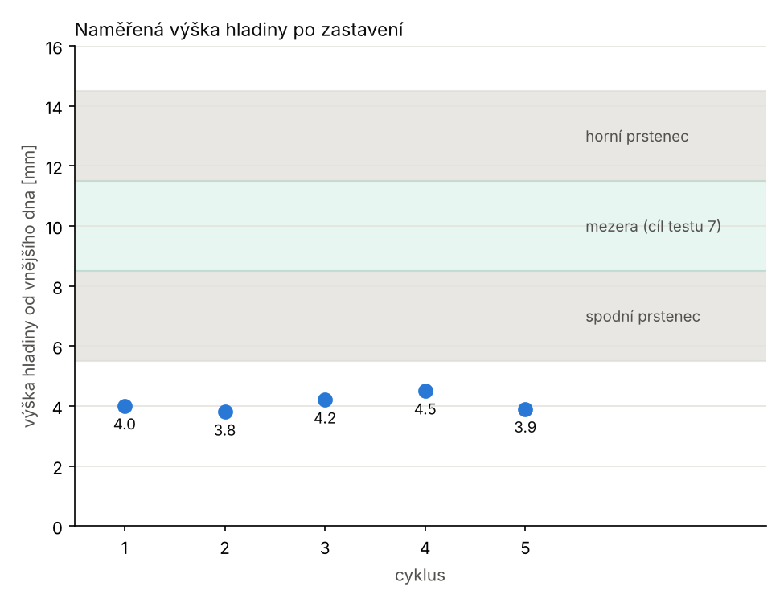
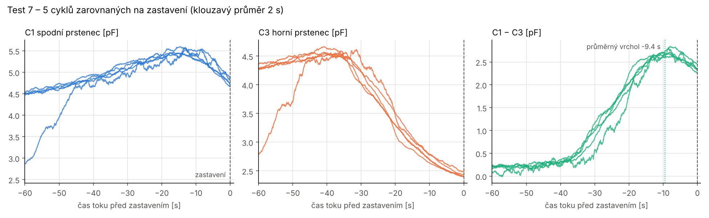

# Analýza testu 7 – zastavení na vrcholu C1 − C3

Log: `TEST 5/6 - zastaveni` z 13. 11. (5 cyklů, režim zastavení, studna
3 / 3 / 3 mm). Grafy: `python3 analyza/test7.py <log> img7`.

## Hlavní výsledek

| cyklus | 1 | 2 | 3 | 4 | 5 | průměr ± sd |
|---|---|---|---|---|---|---|
| naměřená výška [mm] | 4,0 | 3,8 | 4,2 | 4,5 | 3,9 | **4,08 ± 0,28** |
| zbytek v lahvičce [ml] | ≈ 1,25 | ≈ 1,15 | ≈ 1,35 | ≈ 1,5 | ≈ 1,2 | **≈ 1,3 ± 0,15** |

Zbytek je odečtený z tabulky výšek (pod 2 ml přímka neplatí: 1 ml = 3,5 mm,
2 ml = 5,5 mm).

1. **Zastavení je velmi opakovatelné:** ±0,28 mm, tedy ±0,15 ml, při
   neznámé a pokaždé jiné náplni.
2. **Hladina ale stojí 1,5 mm pod spodním prstencem** (5,5 mm), ne
   v mezeře (8,5–11,5 mm). Zastavení je příliš pozdě.
3. **Nezastavila pojistka skoku C1** a nic nezastavilo předčasně. Kontrola
   před tlačením prošla ve všech cyklech (C3/C1 = 0,96–0,99).

## Proč tak nízko: vrchol leží správně, detekce má velké zpoždění

Osa je **čas toku**: počítají se jen vzorky s otevřeným pacientem (`p`, `w`),
kdy se hladina může hýbat. Vytlačený vzduch se nepoužívá.

| příznak (průměr 2 s) | čas toku před zastavením | odhad hladiny* |
|---|---|---|
| C3 klesne na 50 % (střed horního prstence) | −21,5 ± 1,1 s | 13,0 mm (předpoklad) |
| maximum C1 | −13,7 ± 2,1 s | ≈ 9,7 mm |
| **vrchol C1 − C3** | **−9,4 ± 2,0 s** | **≈ 8,0 mm** |
| zastavení detektorem | 0 | 4,1 mm (změřeno) |

\* Odhad předpokládá stálou rychlost poklesu hladiny při stálé rychlosti
motoru. Měřítko dávají dva body: střed horního prstence (13,0 mm, kde C3
prochází 50 %) a změřená výška při zastavení. Vychází ≈ 0,4 mm/s. Je to
jen pomůcka pro orientaci, ne měření.

- **Vrchol C1 − C3 leží tam, kde má:** ≈ 8 mm, na horní hraně spodního
  prstence (8,5 mm), tedy zbytek ≈ 3,7 ml.
- **Detektor ho potvrdí až ≈ 9 s toku po vrcholu** (vrchol → zastavení
  5–10 s podle cyklu). Hrb je široký a plochý: klouzavé okno 4,8 s plus
  pokles o 10 % výšky hrbu. Za tu dobu hladina klesne o ≈ 4 mm (≈ 2,5 ml).
- **C1 v okamžiku zastavení už ~10 s klesá** (5,5 → 4,7 pF): hladina
  opouští spodní prstenec.

## Kratší okno nepomůže

Stejný algoritmus s jinými parametry, přehraný na testu 7 (odhad výšky)
a testu 6 (rezerva do skoku):

| koš / okno / pokles | odhad výšky T7 [mm] | poznámka |
|---|---|---|
| 12 / 8 / 10 % (současný) | 4,0 3,8 4,2 4,5 3,9 | opakovatelné, pozdě |
| 12 / 4 / 10 % | 5,0 4,3 4,9 5,2 4,4 | o ~1 mm výš |
| 12 / 4 / 5 % | **11,0** 5,7 5,6 6,7 5,6 | cyklus 1 předčasně |
| 6 / 4 / 5 % | **11,3** 6,8 6,5 6,8 6,4 | cyklus 1 předčasně |
| 6 / 4 / 3 % | 11,7 **15,0** 8,4 11,0 8,8 | rozházené |

Hrb C1 − C3 je široký a zašuměný. Citlivější potvrzení vrcholu reaguje na
lokální zákmity před skutečným vrcholem. **Konec poklesu C3** (strmost pod
0,2–0,5 × maxima) je ještě horší: rozptyl 5–15 mm.

## Co se děje po zastavení

- **Zavření pacienta sníží C1 o ≈ 0,5 pF** hned (známý vliv ventilu/tlaku,
  test 4). C3 a C2 se změní jen o ≈ 0,1 pF.
- **Klid C1 po zastavení (3,1–4,2 pF) nesouvisí s naměřenou výškou**
  (4,0 → 4,2 pF, 4,5 → 3,1 pF). V cyklu 2 C1 při odvzdušnění spadlo
  o 0,85 pF, výška přitom 3,8 mm. C1 v klidu pod prstencem je ovlivněné
  smočenou stěnou nebo tlakem a **výšku z něj určit nejde**.
- Šum v klidu `k` (lahvička právě vložená) byl 0,08–0,33 pF, po zastavení
  0,005–0,05 pF. Lahvička se po vložení ještě usazuje.

## Chyba ve sketchi (opraveno)

Fáze `s` (0,5 s na ustálení serva po zavření pacienta) se přeskočila:
`sampleFor()` se po detekci hned vrátil, protože příznak detekce byl ještě
nastavený. Klid `d` proto začínal s jedoucím servem. Na výsledek to vliv
nemá. Opraveno: příznak se nuluje před fází `s`.

## Možnosti dál (rozhodnutí obsluhy)

**A. Ponechat vrchol C1 − C3, zbytek ≈ 1,3 ml.** Nejopakovatelnější
z dosud zkoušených kritérií (±0,15 ml). Jehla sahá na dno, takže hladina
4 mm je ještě nad ní. Rezerva je ale malá: v testu 6 (stejný detektor,
stejná rychlost) přišel ostrý **skok** všech kanálů 8–13 s toku po
zastavení. Pokud je skok odkrytí hrotu jehly, jde o ≈ 10 s rezervy před
vzduchem v pacientské cestě. **Nutné ověřit:** po zastavení tlačit dál
a sledovat, kdy se v pacientské hadičce objeví vzduch a jestli to sedí se
skokem.

**B. Zastavovat výš (v mezeře, zbytek ≈ 4 ml), podílem C3/C1.** Na stejné
časové ose by práh C3/C1 (okno 4,8 s) zastavil podle odhadu:

| práh C3/C1 | odhad výšky [mm] | sd |
|---|---|---|
| 0,60 | 11,1 | 0,7 |
| 0,55 | 9,8 | 0,9 |
| 0,52 | 8,5 | 0,7 |

Rozptyl je asi 3× větší než u vrcholu. Plató C3/C1 v mezeře je ≈ 0,55
(test 6: 0,54–0,57), takže práh pod 0,55 se nemusí vůbec dosáhnout. Výšky
jsou jen odhad přes rychlost hladiny a bylo by potřeba je ověřit měřením
jako v testu 7.

**C. Statická kalibrace bez tlačení.** Lahvička se postupně plní známými
objemy (např. 1, 2, … 9 ml), v klidu s odvzdušněnou lahvičkou se změří C1,
C2, C3 a výška. Dá přímou mapu kapacita ↔ výška bez vlivu tlaku a
rychlosti. Doplňuje A i B; dynamické hodnoty (s otevřeným pacientem) se ale
liší o vliv ventilu a tlaku (≈ 0,5 pF).
