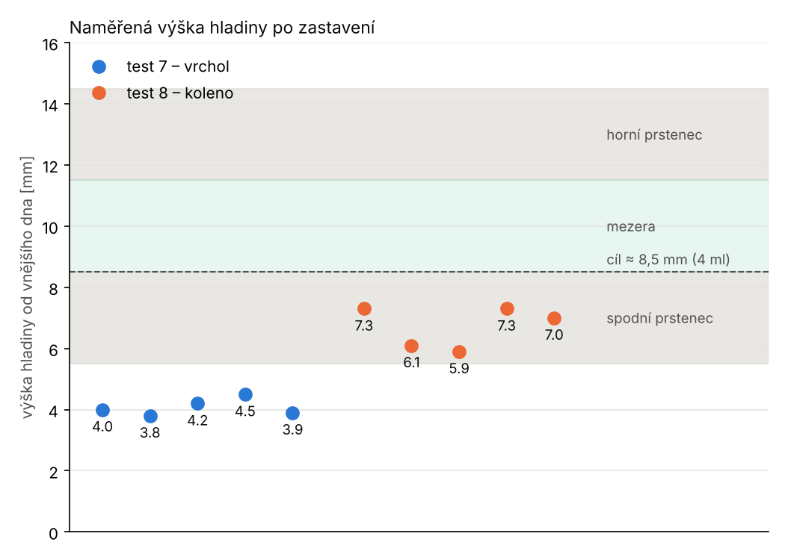
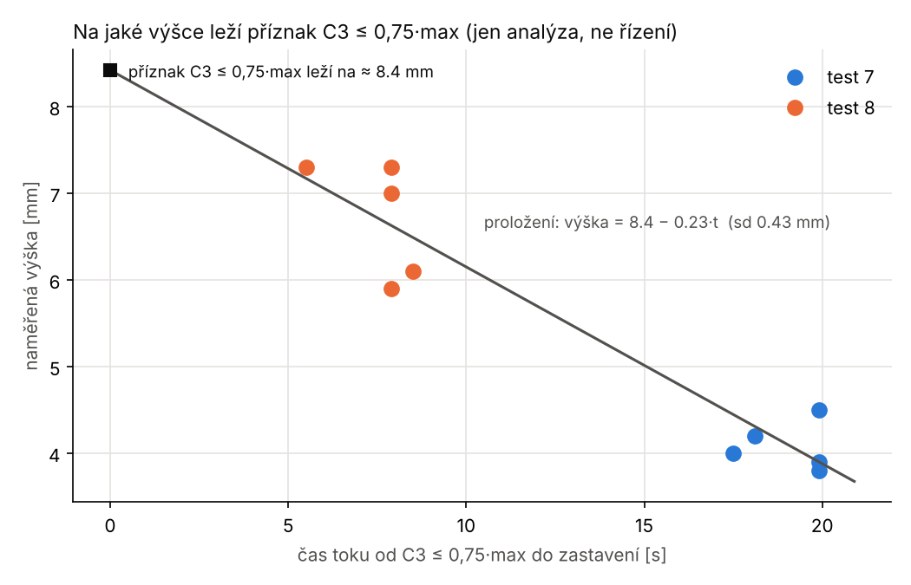
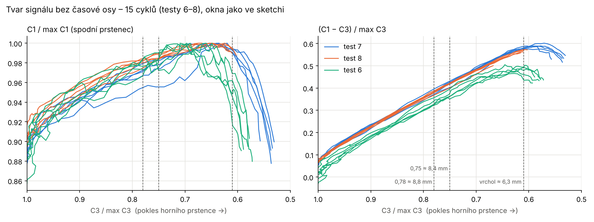
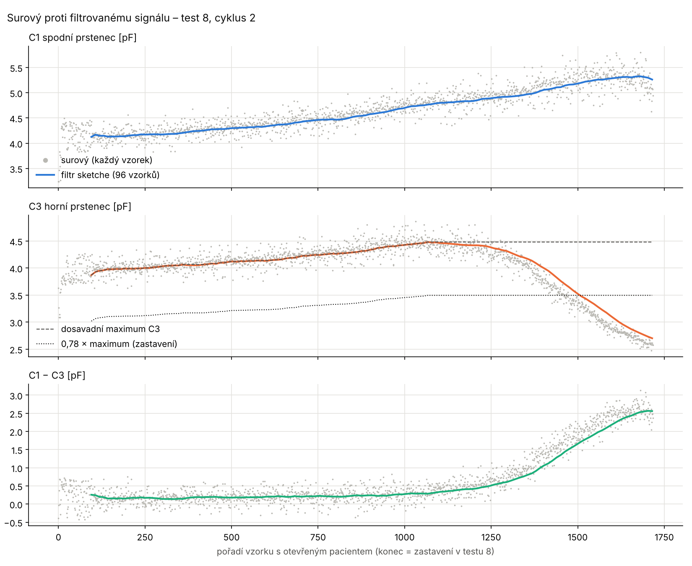

# Analýza testu 8 – zastavení na koleni C1 − C3

Log z 13. 11. (5 cyklů, studna 3 / 3 / 3 mm). Grafy:
`python3 analyza/test8.py <log_test7> <log_test8> img8`.

## Hlavní výsledek

| cyklus | 1 | 2 | 3 | 4 | 5 | průměr ± sd |
|---|---|---|---|---|---|---|
| výška [mm] | 7,3 | 6,1 | 5,9 | 7,3 | 7,0 | **6,72 ± 0,67** |
| zbytek [ml] | 3,2 | 2,4 | 2,3 | 3,2 | 3,0 | **≈ 2,8 ± 0,45** |

- Koleno zastavilo ve **všech 5 cyklech**, záloha ani pojistka skoku
  nezasáhly. Kontrola před tlačením prošla (C3/C1 0,97–1,01).
- Proti testu 7 (4,08 mm) o **2,6 mm výš**, ale **pořád pod cílem 8,5 mm**:
  hladina stojí ve spodním prstenci.
- Koleno nastalo prakticky **na vrcholu** C1 − C3 (d při zastavení = dmax
  nebo do 0,6 s po něm). Vrchol tedy leží ≈ 6–7 mm, ne ≈ 8 mm, jak
  odhadovala analýza testu 7.

## Kde leží příznaky signálu – poprvé podle měření

Testy 7 a 8 dávají **10 změřených výšek** při různých okamžicích
zastavení. Z nich jde zjistit, na jaké výšce hladiny leží který příznak
signálu: pro každý cyklus se vezme čas toku (pacient otevřený) od příznaku
do zastavení a proloží se přímkou proti změřené výšce. Průsečík s nulou
je výška, na které příznak leží.

> **Jen nástroj analýzy.** Rychlost klesání hladiny se do řízení
> nedostane. Kritérium zastavení je čistě signálové (C3 proti vlastnímu
> maximu, C3 proti C1), o čase ani rychlosti nic neví.

Okna jako ve sketchi (koš 12 vzorků, okno 8 košů):

| příznak | leží na | rozptyl kolem přímky |
|---|---|---|
| aktivace C3 ≤ 0,85 × max | 9,3 mm | 0,49 mm |
| **C3 ≤ 0,78 × max** | **8,8 mm** | 0,43 mm |
| **C3 ≤ 0,75 × max** | **8,4 mm** | 0,43 mm |
| C3/C1 ≤ 0,68 | 8,9 mm | 0,45 mm |
| C3/C1 ≤ 0,65 | 8,5 mm | 0,45 mm |
| vrchol C1 − C3 | ≈ 6,3 mm | – |

Rozptyl kolem přímky (±0,45 mm) zahrnuje i chybu ručního měření výšky.
Všechny příznaky dávají stejný sklon, takže výsledek je vnitřně
konzistentní.

**Oprava dřívějšího odhadu:** v analýze testu 7 se předpokládalo, že
C3 prochází 50 % ve středu horního prstence (13 mm). To neplatí. Přechody
leží níž, než odpovídá geometrii prstenců, a vrchol rozdílu je ≈ 6,3 mm,
ne 8 mm.

## Přehrání kandidátů (signálová kritéria)

Výška v okamžiku, kdy by kritérium zastavilo. U testů 7 a 8 ze změřené
výšky a proložení, u testu 6 (bez měření) proti zastavení vrcholem
(= 4,08 mm z testu 7):

| kritérium | T7 | T8 | T6 | průměr ± sd | rozsah |
|---|---|---|---|---|---|
| C3 ≤ 0,75 × max | 7,8 8,2 8,2 8,9 8,3 | 8,5 8,0 7,6 9,0 8,7 | 7,7 8,2 8,6 8,5 7,7 | 8,3 ± 0,44 | 7,6–9,0 |
| **C3 ≤ 0,78 × max** | 8,1 8,6 8,4 9,1 8,7 | 8,8 8,4 8,0 9,4 9,1 | 8,2 8,5 9,2 8,7 8,2 | **8,6 ± 0,43** | **8,0–9,4** |
| C3/C1 ≤ 0,68 | 8,1 8,6 8,6 9,3 8,7 | 8,8 8,4 8,2 9,6 9,1 | 7,9 8,2 8,9 8,7 7,8 | 8,6 ± 0,51 | 7,8–9,6 |
| první z C3 ≤ 0,78 × max / C3/C1 ≤ 0,68 | | | | 8,7 ± 0,45 | 8,1–9,6 |
| koleno (test 8) | | 7,3 6,1 5,9 7,3 7,0 | | 6,7 ± 0,67 | změřeno |

- **C3 ≤ 0,78 × vlastní maximum** má nejmenší rozptyl a ve všech
  15 cyklech se spustilo. Je to podíl hodnot téhož prstence, takže na
  zesílení (samolepka, okolí) nezávisí. Šum ho jen uspíší (první
  překročení), takže míří do bezpečného směru.
- **C3/C1 ≤ 0,68** je podobné, rozptyl o něco větší. Od plató v mezeře
  (0,50–0,57) má odstup 0,11–0,18, mnohem víc než dřívější práh 0,60.

## Doporučení: test 9

Zastavit na **prvním** z:
1. C3 ≤ 0,78 × vlastní maximum v běhu,
2. C3/C1 ≤ 0,68,
3. záloha koleno, pak vrchol, poslední záchrana skok C1.

Očekávání podle přehrání: ≈ 8,7 ± 0,45 mm (8,1–9,6 mm). Ověřit stejně
jako v testech 7 a 8 měřením výšky. Výšky jsou zatím odvozené (proložení
přes testy 7 a 8), tentokrát ale z měřených dat, ne z předpokladu.

## Šablona tvaru signálu (diskuse před testem 9)

Otázka: odvodit analytický tvar průběhu, z počátku běhu ho přeškálovat,
zastavit v předpovězeném bodě a skutečný signál použít jako kontrolu shody.

**Na časové ose to nejde.** Šablona v čase potřebuje rychlost hladiny
a ta se mezi během mění (tlak u pacienta, doplnění vzduchu, pauzy).
**Bez času to funguje:** C1 a C3 se vynesou proti sobě, poměrně k
vlastnímu maximu v běhu. Postup hladiny pak udává pokles horního prstence
`C3 / max C3`. Rychlost ani čas v tom nejsou.

*Graf vznikl při analýze (15 cyklů testů 6–8, okna jako ve sketchi).*

| v bodě vrcholu C1 − C3 | průměr ± sd (15 cyklů) |
|---|---|
| `C3 / max C3` | **0,613 ± 0,024** |
| `C1 / max C1` | 0,984 ± 0,012 |
| `(C1 − C3) / max C3` (výška hrbu) | 0,543 ± 0,047 (test 6 ≈ 0,49, testy 7–8 ≈ 0,58) |

- **Poloha vrcholu je v šabloně pevná**: vrchol nastává při
  `C3 ≈ 0,61 × max C3`. Škálování jedním parametrem (vlastní maximum C3)
  stačí. Výška hrbu se mezi sezeními liší až o 20 %, proto **nepředpovídat
  z amplitudy**.
- **Vrchol ale leží ≈ 6,3 mm (≈ 2,5 ml)**, pod cílem 8,5 mm. Šablona umožní
  zastavit v libovolném jejím bodě: cíl 8,5 mm odpovídá `C3 ≈ 0,75–0,78 × max`.
  Navržené kritérium testu 9 tedy **je** zastavení podle šablony
  škálované vlastním maximem C3.
- Plnější šablona (víc parametrů z počátku běhu) nepomůže. Na začátku
  je hladina nad `SHLD2` a klidové hodnoty se mezi cykly liší
  (C3 2,6–3,8 pF), takže o pozdějším průběhu skoro nic neříkají.
  Spolehlivá kotva je jen maximum C3.

**Kontrola shody, nový přínos:** `C1 / max C1` proti `C3 / max C3` leží
ve všech 15 cyklech v úzkém pásu (±0,01–0,02), dokud C3 neklesne na ≈ 0,62.
Odchylka znamená, že signál nekopíruje šablonu (porucha elektrody, bublina,
přesunutá lahvička, špatná mapa kanálů):
- C1 klesá dřív, než C3 dosáhne ≈ 0,65 × max → hladina jde jinudy, než má
  → **stop**,
- `C1 − C3` neroste, když C3 klesá → stop/pauza,
- C3 klesá, ale C1 se nehýbe ani v tlačení → kontrola senzoru.

## Surový proti filtrovanému signálu

Test 8, cyklus 2, vzorky jen s otevřeným pacientem. Šum surového signálu
≈ 0,13 pF (C1) a 0,10 pF (C3) na vzorek. Filtr sketche (průměr 96 vzorků)
na prudkém sestupu C3 **zaostává** za surovým signálem o ≈ 0,1–0,15 pF.
O čem filtr rozhoduje, to se tím posune později (níž). Ve výšce hladiny je
to zpoždění tím větší, čím rychleji hladina klesá. S lepším stíněním
(nižší šum) půjde filtr zkrátit a zpoždění zmenšit.
