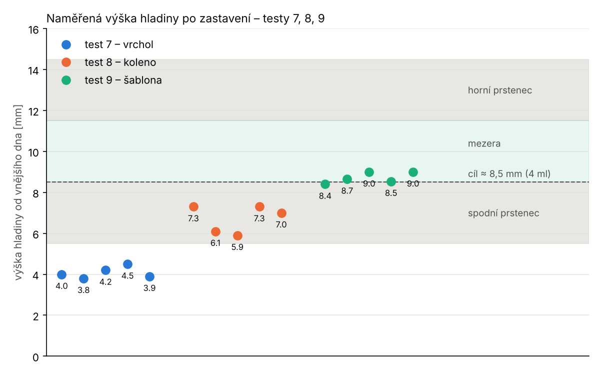

# Analýza testu 9 – zastavení podle šablony C3 / max C3

Log z 13. 11. 16:19 (sketch testu 9, 5 cyklů, studna 3 / 3 / 3 mm).
Graf: `python3 analyza/test9.py <log_t7> <log_t8> <log_t9> img9`.

## Výsledek

| cyklus | 1 | 2 | 3 | 4 | 5 | průměr ± sd |
|---|---|---|---|---|---|---|
| zastavilo | šablona | podíl | šablona | podíl | podíl | |
| C3 / max C3 při zastavení | 0,775 | 0,781 | 0,776 | 0,781 | 0,785 | |
| výška [mm] | 8,4 | 8,65 | 9,0 | 8,54 | 9,0 | **8,72 ± 0,27** |
| zbytek [ml] | 3,9 | 4,1 | 4,3 | 4,0 | 4,3 | **4,15 ± 0,18** |

- **Cíl splněn:** hladina ≈ 8,5–9 mm, zbytek ≈ 4 ml, rozptyl ±0,27 mm
  (stejně malý jako u vrcholu v testu 7, ±0,28 mm).
- **Předpověď sedí:** z testů 7 a 8 vyšlo 8,7 ± 0,45 mm (13 bodů: 9,0 mm),
  změřeno 8,72 mm.
- Šablona a podíl C3/C1 nastávají prakticky současně
  (C3 / max C3 = 0,775–0,785). Které z nich zastaví, je náhoda.
- **Kontrola shody: ve všech cyklech `shoda OK`**, žádné `SHODA ***`.
  Při zastavení C1 / max C1 = 0,999–1,000 (spodní prstenec plně zakrytý),
  nárůst rozdílu 0,33–0,35 × max C3 (práh 0,15).
- Záloha (koleno, vrchol) ani pojistka skoku nezasáhly. Kontrola před
  tlačením C3/C1 = 0,955–0,981.

| test | kritérium | výška [mm] | zbytek [ml] |
|---|---|---|---|
| 7 | vrchol C1 − C3 | 4,08 ± 0,28 | 1,05 |
| 8 | koleno C1 − C3 | 6,72 ± 0,67 | 2,8 |
| **9** | **šablona C3 / max C3** | **8,72 ± 0,27** | **4,15** |

## Co zbývá před převodem do produkce

1. **Kontrola přítomnosti lahvičky.** Prázdná studna prošla kontrolou
   C3/C1 (log 15:46, cyklus 4). Před tlačením porovnat klid se suchou
   hodnotou bez lahvičky (C1, C3 aspoň o 0,5 pF nad ní).
2. **Kontrola výchozího stavu přísněji:** C3/C1 ≥ 0,90 (naměřeno
   0,95–1,01 ve 15 startech).
3. **Maximum z plató:** C3/C1 v okamžiku maxima C3 ≥ 0,88, jinak netlačit
   (začátek na sestupu by maximum podcenil a zastavil níž).
4. **Koleno ze zálohy vyřadit** – závisí na rychlosti toku.
5. **Start uprostřed plató (iterace):** po zastavení ≈ 4,2 ml + 3 ml roztoku
   ≈ 7,2 ml ≈ 13,3 mm. Test s náplní ≈ 7 ml ověří, že šablona zastaví stejně.
6. **Pauza / přerušení uprostřed sestupu** – maximum i stav detektoru se
   drží, ověřit na zařízení.
